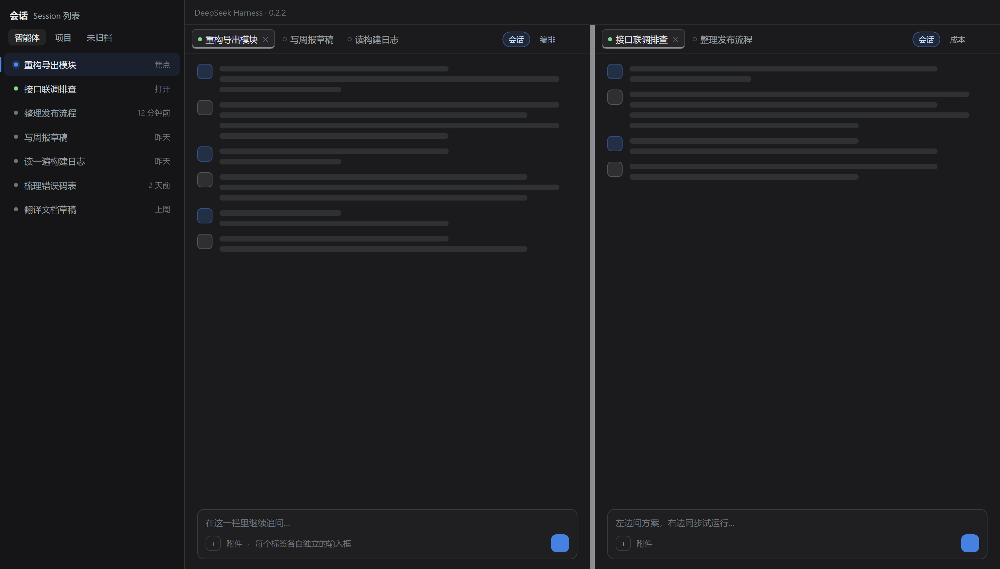
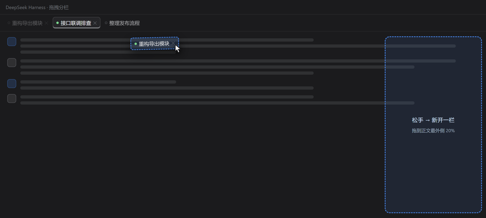
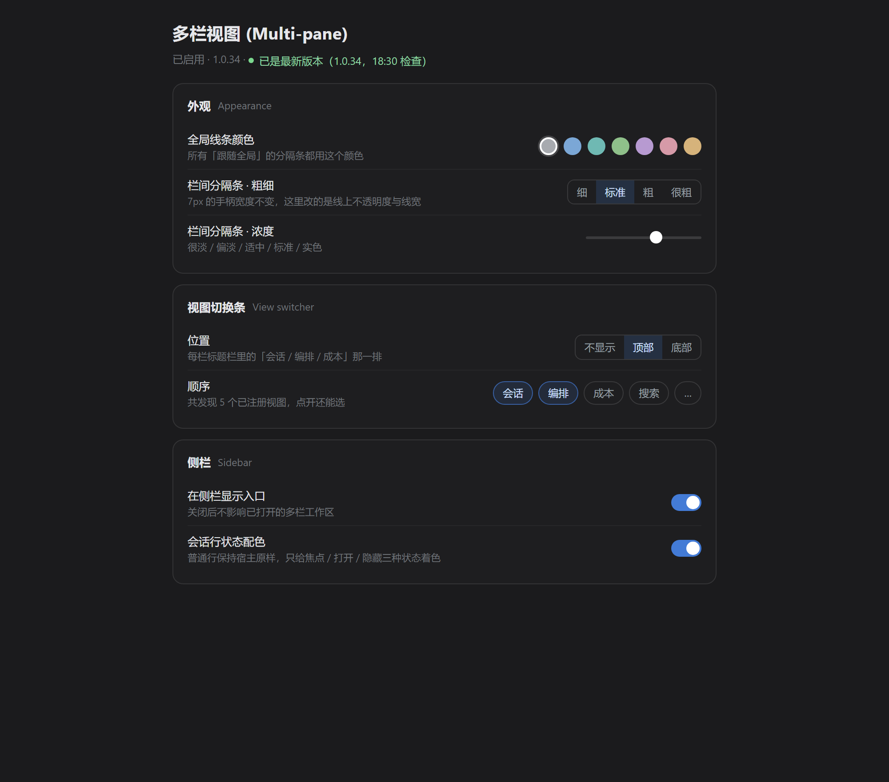

# dsh-multipane

Turn the **DeepSeek Harness main area** into a multi-pane tabbed workspace: up to four panes side by side, each with its own tab strip and its own composer. Drag a tab to a pane edge to split.

[中文说明](README.md) · [Changelog](#changelog) · [Install](#install)



> The images in this README are rendered from the plugin's real layout and colours — they are illustrations, not screen captures.

---

## The problem it solves

DSH shows one conversation at a time. Real work rarely looks like that: you want the plan on the left while you try it on the right, or the logs above and the code below. Every switch costs you the context you just built up.

Multi-pane puts those conversations on one screen, and keeps them **independent**: tabs, composer and the view switcher all belong to their own pane.

## What you get

| Capability | Notes |
| --- | --- |
| Up to four panes | `MAX_PANES = 4`; extra tabs stay in their pane |
| Per-pane tab strip | Drag to reorder, double-click to close (optional), right-click to lock |
| Per-pane composer | Type in a pane and it goes to that pane's conversation — no focus juggling |
| Drag to split | Drop a tab (or a sidebar session) on the **outer 20%** of a pane body to open a new pane on that side |
| Sidebar state colours | Only *focused / open / hidden* rows are tinted — **untouched rows stay exactly as the host renders them** |
| View switcher | The "Conversation / Orchestrate / Cost…" row in each pane header; top, bottom or hidden, order configurable |
| Attachment targeting | Drop a file on a pane and the attachment lands in that pane only |
| Bilingual | Follows the host language; switches instantly, no restart |
| Layout persistence | Pane widths, tabs per pane and the active tab are remembered |

## Install

### npm (recommended)

```bash
npx @deepseek-ai/dsh plugin --profile desktop add dsh-multipane
```

### Straight from GitHub

```bash
npx @deepseek-ai/dsh plugin --profile desktop add github:weiaisuyan/dsh-split-view
```

> The repository is called `dsh-split-view`, but the **npm package is `dsh-multipane`**. Install by package name.

### Restart DSH afterwards

The plugin's client bundle can hot-swap, but **manifest changes such as `exports` entries are only read when the host starts or the loader entry restarts**. If you upgraded from an older version and the plugin list still shows an English-only name, restart the host once.

### ⚠️ Do not enable together with `dsh-split-view` by luckybilly

Both plugins insert a loader entry with `id: split-view`, so the ids collide and the main area renders incorrectly. Remove one before installing the other.

### Upgrade / uninstall

```bash
# upgrade
npx @deepseek-ai/dsh plugin --profile desktop add dsh-multipane@latest

# uninstall
npx @deepseek-ai/dsh plugin --profile desktop remove dsh-multipane
```


## Using it

| Goal | How |
| --- | --- |
| Split | Drag a tab (or a sidebar session) onto the **outer 20%** of a pane body |
| Move a tab into another pane | Drag it onto the **middle** of the target pane |
| Close a tab | Double-click it (can be disabled in settings), or click its ✕ |
| Lock a pane | Right-click a tab → Lock; a locked pane cannot be dragged away and its tabs cannot be closed |
| Resize panes | Drag the divider between two panes |
| Hide the sidebar entry | Settings → Sidebar → Show entry in sidebar |



## Settings

Available under DSH Settings, or by clicking the "Multi-pane" entry in the sidebar.



| Group | What you can tune |
| --- | --- |
| Appearance | Global line colour (7 presets + custom), divider width and opacity, active-tab focus line, tab hover background; each item can follow the global value or override it |
| View switcher | Position (top / bottom / hidden), order, which views to hide |
| Sidebar | Show the sidebar entry, session-row colouring switch, intensity of the focused / open / hidden tints |
| Behaviour | Double-click to close, drop-zone size |
| Data | Export settings as JSON / restore from JSON / reset to defaults |

Everything is stored in **local `localStorage` (key `dsh-split-view:prefs:v1`). Nothing is uploaded and nothing phones home.

## Language

The plugin follows the host language — no separate setting:

| Host language | Sidebar entry | Plugin list card | Settings title |
| --- | --- | --- | --- |
| 中文 | 多栏视图 | 多栏视图 (dsh-multipane) | 多栏视图 (Multi-pane) |
| English | Multi-pane | Multi-pane | 多栏视图 (Multi-pane) |

The settings title is intentionally bilingual so the plugin is recognisable in either UI language; every setting inside follows the host language and switches without a restart.

## Update check

The settings page shows the current version and offers a "Check for updates" action:

- it compares against `https://registry.npmjs.org/dsh-multipane/latest`;
- when a newer version exists, one click calls the host-side `POST /dsh-multipane/update` route, which downloads the npm tarball, extracts it, backs up the old files and rolls back on failure;
- this self-update **only runs when you click it** — no background polling. It bypasses pnpm (no lockfile rewrite, no release-age cooldown) and only appends an `|| <current version>` allowance to an existing `dsh-multipane` line in `pnpm-workspace.yaml`.

## Compatibility

- DSH `>= 0.2.1-rc.5` (desktop and web profiles)
- Client platform: `web` (the Chromium runtime inside DSH desktop)
- Four panes maximum; pane widths are stored as ratios so resizing the window does not break the layout

## Known limitations

- Splitting only triggers on the **outer 20%** of a pane body; the middle is "merge into this pane";
- Four panes is a hard cap — a fifth tab stays where it is;
- Mutually exclusive with luckybilly's `dsh-split-view` (see above);
- Disabling the plugin restores the host's session list immediately, but an already open multi-pane workspace is not collapsed automatically — use the "Conversation" item in the view switcher to return to the single-pane view.

## Feedback & support

| Channel | Good for | Where |
| --- | --- | --- |
| **GitHub Issues** (preferred) | Bugs, feature requests, usage questions — searchable and trackable | <https://github.com/weiaisuyan/dsh-split-view/issues/new/choose> |
| Email | Anything you would rather not post publicly (including security reports) | <1450719125@qq.com> |
| Marketplace page | Short description, install command, current version | <https://awesome-dsh-plugin.com/p/weiaisuyan/dsh-split-view/> |

When reporting, please include:

- **Version** — the `已是 最新版本（1.0.x，…）` line at the bottom of the settings page, or `version` in `~/.dsh/profiles/<profile>/node_modules/dsh-multipane/package.json`
- **DSH version** and OS (Windows / macOS / Linux)
- **UI language** (中文 / English) — the plugin ships two string sets, and some bugs only reproduce in one
- **Steps to reproduce**, plus any `[split-view]` error from the F12 console

## Development

The shipped JavaScript **is** the source — there is no build step:

```
lib/index.js      host side: self-update routes (GET /dsh-multipane/status, POST /dsh-multipane/update)
lib/client.js     client side: the whole workspace + settings page + sidebar marks (single file, ~9.4k lines)
locale/*.json     plugin-list card title and description, per language (meta.title / meta.description)
cordis.patch.yml  inserts the `id: split-view` loader entry
```

Restart the host to pick up changes. Before opening a PR, run the bundled consistency check:

```bash
node scripts/check-names.cjs     # package name / version / release-age allowance must agree
```

## Changelog

### 1.0.48 (2026-11-11)

- **Ctrl+Tab / Ctrl+Shift+Tab now cross panes.** Before, cycling only ran inside the current pane's tabs, so a pane with a single tab did nothing and the neighbouring pane was unreachable from the keyboard. All panes' tabs are now chained into one ring in left-to-right order (and in-strip order within a pane): the tab after a pane's last one is the next pane's first, the last pane wraps back to the first, and the reverse direction mirrors that. Focus follows the target tab, so you can keep typing in the pane you landed in.
- **Bigger "+" button on the tab strip.** It used to be a 20x20 box, shorter than the tabs and fiddly to hit. It now fills the strip's full height (same height as the tabs) and is 26px wide, with the tabs' hover background and 6px radius. Only this one button inside the tab strip changed; buttons on the settings page and elsewhere are untouched.

### 1.0.47 (2026-11-11)

- **Fixed the rail being absent the first time a pane opens** (it only appeared after dragging one pane very wide). The host's turn navigator sets its `initialized` flag on a real event, and that one chance is already gone when a pane first mounts; nudging the width slightly does not wake it up, only the scroll produced by a big reflow does - which is why two, three and four panes were all blank after a restart and switching the active pane did nothing. A pane now kicks itself adaptively: every 250ms it checks whether the rail is there and, if not, dispatches a synthetic `scroll` event (no scrolling, no layout change), escalating to an 8px real scroll that is immediately restored every third attempt. It stops as soon as the rail appears, capped at five seconds.

### 1.0.46 (2026-11-11)

- **Fixed the turn navigator flickering in and out, and never coming back after a resize**: 1.0.45 hid the rail below 480px with `display:none`, but the host's rail measures its own height for a virtual scroller - taking it out of layout recorded a height of 0 with nothing to recompute it when the pane grew back, so the rail stayed gone. The rail now keeps its layout at every width and is hidden only by `visibility` below 240px, which leaves the measurement valid and restores instantly.

### 1.0.45 (2026-11-11)

- **Brought the host's turn navigator back inside panes** (the column of short marks on the right of a conversation, with the "turn N" hover preview). The plugin never removed it: the host hides the rail whenever a conversation is narrower than 900px (`@container (width<=900px)`), and a two-pane layout puts each pane at roughly 650px, so the rule fires as soon as you split. The plugin now re-enables the rail inside panes only (still hidden below 480px), in CSS alone - no host DOM is touched and no React state is involved.

### 1.0.44 (2026-11-11)

- **Rolled back the 1.0.43 "single menu" attempt**: a narrow pane is back to two independent menus — the host's "More actions" and the plugin's "⋯". 1.0.43 merged the host menu into ours, which both broke it ("one row, then the menu vanished") and depended on reparenting the host's DOM node. Now each menu does its own job: the plugin's "⋯" only holds genuinely clipped buttons, the host's "⋯" uses its own native menu, and nothing is lost. All fixes up to 1.0.42 are unchanged.

### 1.0.42 (2026-11-11)

- **Fixed the session-header "More actions" menu not opening / showing only one item**: the host renders this menu as an **inline absolutely-positioned** popover inside the button's element, and the pane header's two `overflow:hidden` layers clipped it away, so clicking did nothing. Both layers are now `overflow:visible` and the header bar's `z-index` is raised to 30 so the popover can overlay the conversation; when buttons overflow they are still folded into the plugin's own "…", so panes don't bleed.

### 1.0.41 (2026-11-11)

- **Fixed the session-header menu showing only "More actions" with a dead click**: to avoid two "more" menus in the top-right row, the plugin used to hide the host's own "More actions" button inside its own "⋯" menu and forward a click to the hidden button. The host's newer menu positions itself from the anchor button's rect, which is zero while hidden, so it never opened. The host's button now stays visible and uses its own menu; the plugin's "⋯" only holds buttons that are genuinely clipped

### 1.0.40 (2026-11-11)

- **Fixed the second "Context" view showing a huge blank with a few lines at the bottom**: the previous version applied the "dock content to the bottom" rule too broadly, so views that need to fill the height and scroll on their own (trajectory / context / team) were collapsed to content height too. It is now scoped to the chat view with `:has([data-chat-flow])`, and the other views are back to normal

### 1.0.39 (2026-11-11)

- **Fixed the pulse peak looking brighter than the base even when both are set to the same value**: in the real list the row background and the pulse layer stack (15% base plus 15% pulse composites to 27.75%), while the settings preview uses a single layer — so the same number always looked brighter in the list. Pulsing rows now hand the background over to the pulse layer, making the on-screen opacity equal the configured value, matching the preview

### 1.0.37 (2026-11-11)

- **Fixed Ctrl+W dying on a second machine**: the host's Ctrl+W binding lives in a per-device file (`keybindings.json` in Electron's userData), so configuring one machine left the next one back on "close the window". The plugin now releases that binding itself on startup (via the host's `ctx.shortcuts.edit()`) and restores it when the switch is turned off or the plugin is disabled — no manual file copying on new machines

### 1.0.36 (2026-11-11)

- **Ctrl+W closes the tab, with two switches**: the settings page gains "Ctrl+W closes the tab" (master) and "Close the window on the last tab" (depends on the former; greyed out and disabled while the master is off). Pressing Ctrl+W on the last remaining tab now closes the window instead of appearing to do nothing
- **Bar thickness is now a continuous slider**: "Focused row bar thickness" and "Open-row bar thickness" were 1–8px chip buttons; they are sliders now, 0.5% steps up to 30% of the session-row width. Existing px values are converted to percentages automatically
- **Dragging a tab no longer lights up every divider**: only the divider the pointer is actually over highlights
- **New "Interaction" section in settings** explaining that motion follows the system animation setting, so the app stays still when Windows animations are off (by design)

### 1.0.35 (2026-11-10)

- **Fixed the janky pulse in the session list**: the breathing effect no longer restyles and repaints the whole row every frame; it animates the opacity of a pseudo-element instead, which the compositor handles. Same look, a fraction of the cost
- **Removed the dead "Unopened row text brightness" slider**: it stopped affecting anything once 1.0.34 dropped the dimming rules
- **Documentation rewritten**: a complete Chinese README plus a complete English one ([README.en.md](README.en.md))
- **Three UI illustrations added**: overview, drag-to-split, settings (rendered from the real layout and colours, not screen grabs)
- **New npm description**, aligned with the plugin-list description in both languages
- **New "Feedback & support"** section: issue templates, email, marketplace page
- **Author-local scripts removed from the repository**, plus scripts/check-privacy.cjs and a CI gate so personal data cannot creep back in

### 1.0.34 (2026-11-10)

- **Bilingual zh/en UI**: sidebar entry, every setting, tab strips, context menus and hints (~300 strings), following the host language with instant switching
- **Localised name in the plugin list**: added `locale/zh.json` + `locale/en.json` with a `./locale/*.json` export, so the card reads "多栏视图 (dsh-multipane)" / "Multi-pane"
- **Fixed the settings page losing its stylesheet**: the heartbeat no longer deletes the style element while the plugin is disabled, and the page no longer flashes unstyled
- **Fixed host session rows being restyled while the plugin was disabled**: row marks are cleared on disable, so untouched rows are fully restored
- **Fixed dimmed session rows**: removed three `opacity` rules that dimmed the entire row, including pinned rows and hover actions; only focused / open / hidden rows are tinted
- **Fixed drag-and-drop and the "＋" file picker breaking while disabled**: drop listeners and the composer attachment slot now mount and unmount with the master switch, and a drop with no valid target is no longer swallowed

### 1.0.33 and earlier

See [GitHub Releases](https://github.com/weiaisuyan/dsh-split-view/releases) and the commit history.

## License

[MIT](LICENSE)
