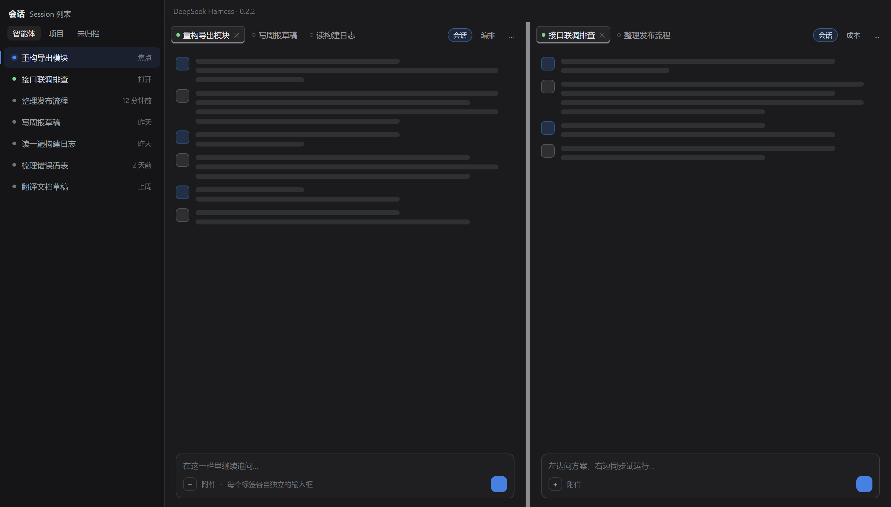
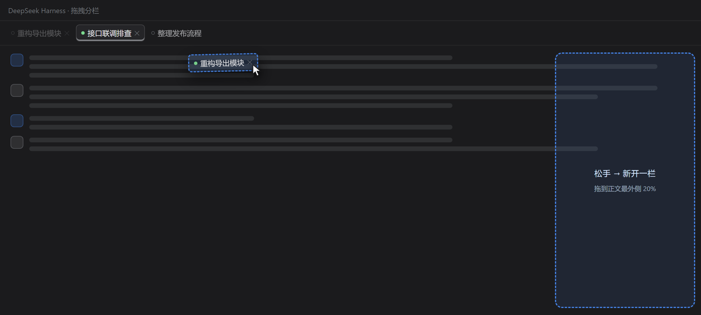
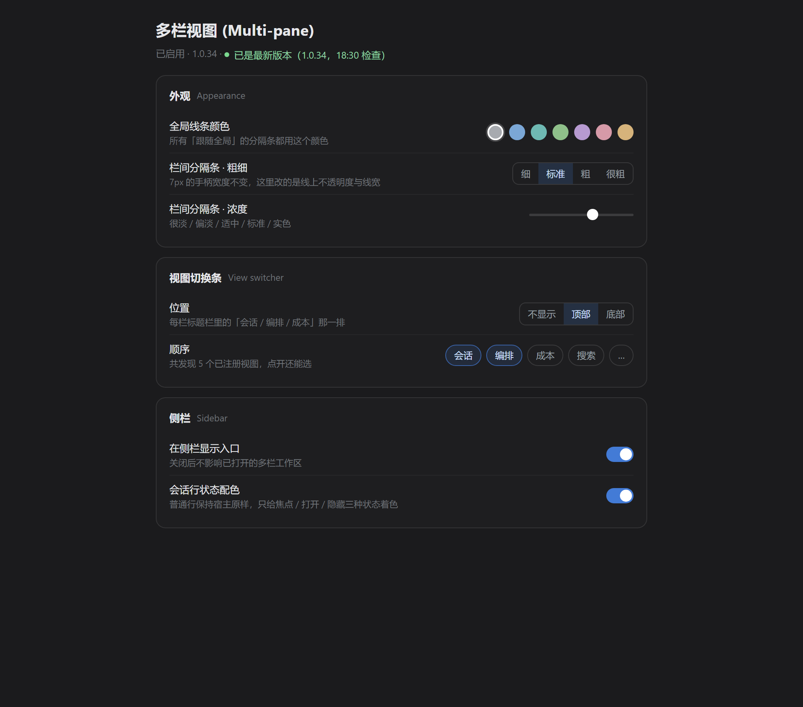

# dsh-multipane（多栏视图）

把 **DeepSeek Harness 的主区**换成一个多栏标签工作区：最多四栏并排，每一栏都有自己的标签条、自己的输入框，栏与栏之间可以拖动分隔、拖标签即可分栏。

[English](README.en.md) · [更新记录](#更新记录) · [安装](#安装)



> 上面的图是按插件真实布局与配色渲染的示意图，不是屏幕截图。

---

## 它解决什么问题

DSH 默认一次只能看一个会话。真要对照着干活——左边问方案、右边同步试运行；上面读日志、下面改代码——就得来回切，切一次丢一次上下文。

多栏视图把这些会话摆到同一屏上，并且**每栏独立**：标签、输入框、视图切换条都归自己那一栏管，互不干扰。

## 主要能力

| 能力 | 说明 |
| --- | --- |
| 最多四栏 | `MAX_PANES = 4`，超出的标签留在原栏 |
| 每栏独立标签条 | 拖拽排序、双击关闭（可关掉这个行为）、右键锁定 |
| 每栏独立输入框 | 在哪一栏打字就发给哪一栏的会话，不用先抢焦点 |
| 拖拽分栏 | 把标签或侧栏会话拖到某栏正文的**最外侧 20%**，就在那一侧新开一栏 |
| 侧栏状态配色 | 只给「焦点 / 打开 / 隐藏」三种行上色，**普通行一个像素都不动** |
| 视图切换条 | 每栏标题栏里的「会话 / 编排 / 成本…」一排，位置可放顶部/底部/隐藏，顺序可调 |
| 附件定向 | 把文件拖到某一栏，就只在那一栏插入附件 |
| 中英双语 | 跟随宿主语言，切语言即时生效，不用重启 |
| 布局持久化 | 栏宽、栏内标签、各栏当前标签都记住，下次打开还在 |

## 安装

### npm（推荐）

```bash
npx @deepseek-ai/dsh plugin --profile desktop add dsh-multipane
```

### GitHub 直装

```bash
npx @deepseek-ai/dsh plugin --profile desktop add github:weiaisuyan/dsh-split-view
```

> 包名和仓库名不一样：仓库叫 `dsh-split-view`，**npm 包名是 `dsh-multipane`**。装的时候用包名，别搜混。

### 装完要重启 DSH

插件自己的客户端代码改动可以被宿主热替换，但 **`package.json` 里的导出一类清单变更，宿主只在 entry 启动或重启时读取**。如果你是从旧版本升级上来、并且没看到插件列表里的中文名，重启一次宿主即可。

### ⚠️ 不要和 `dsh-split-view`（作者 luckybilly）同时启用

两个插件都会往 `cordis.patch.yml` 里插入 `id: split-view` 的 loader entry，**entry id 直接撞车**，同时启用会让主区渲染错乱。要装这个就先卸那个。

### 升级 / 卸载

```bash
# 升级
npx @deepseek-ai/dsh plugin --profile desktop add dsh-multipane@latest

# 卸载
npx @deepseek-ai/dsh plugin --profile desktop remove dsh-multipane
```


## 怎么用

| 你想干什么 | 怎么做 |
| --- | --- |
| 分栏 | 拖标签（或侧栏会话）到某栏正文的**最外侧 20%**，松手即新开一栏 |
| 把标签挪到别的栏 | 拖到目标栏的**中间**区域，落进那一栏 |
| 关闭标签 | 双击标签（设置里可关掉双击关闭）；或点标签右侧的 ✕ |
| 锁定栏 | 右键标签 → 锁定，锁住后该栏不会被拖走、标签不能被关 |
| 调栏宽 | 拖两栏之间的分隔条 |
| 关掉侧栏入口 | 设置 → 侧栏 → 在侧栏显示入口 |



## 设置

设置页在 DSH 设置里，也可以直接点侧栏的「多栏视图」入口。



| 分组 | 能调什么 |
| --- | --- |
| 外观 | 全局线条颜色（7 个预设色 + 自定义）、栏间分隔条的粗细与浓度、标签焦点线、栏内标签悬停底色；每一项都可以「跟随全局」或单独设 |
| 视图切换条 | 位置（顶部 / 底部 / 不显示）、顺序、隐藏哪些视图 |
| 侧栏 | 是否在侧栏显示入口、会话行状态配色开关、焦点/打开/隐藏三档颜色的强弱 |
| 行为 | 双击关闭标签、拖拽分栏的落区大小 |
| 数据 | 导出当前设置成 JSON / 从 JSON 恢复 / 一键恢复默认 |

所有设置都存在**本机** `localStorage`（键名 `dsh-split-view:prefs:v1`），不上传、不联网。

## 语言

插件跟随宿主语言，**不需要单独设置**：

| 宿主语言 | 侧栏入口 | 插件列表卡片 | 设置页标题 |
| --- | --- | --- | --- |
| 中文 | 多栏视图 | 多栏视图 (dsh-multipane) | 多栏视图 (Multi-pane) |
| English | Multi-pane | Multi-pane | 多栏视图 (Multi-pane) |

设置页标题故意固定双语，方便在两种界面下都能认出是哪个插件；页面里的每一个设置项都跟随宿主语言切换，无需重启。

## 检查更新

设置页底部会显示当前版本，并可以点「检查更新」：

- 比对 `https://registry.npmjs.org/dsh-multipane/latest` 的版本号；
- 有新版本时，可以点一键更新——宿主侧的 `POST /dsh-multipane/update` 路由会拉 npm tarball、解到临时目录、备份旧文件后覆盖，失败自动回滚；
- 这个自更新**只在你点击时触发**，不点击不会联网，也不写你的 profile 清单（它绕过 pnpm，不改 lock、不受 pnpm 冷却期限制；只会在 `pnpm-workspace.yaml` 里已有的那一行后面补一个 `|| <当前版本>` 的允许分支）。

## 兼容性

- DSH `>= 0.2.1-rc.5`（desktop / web profile 均可）
- 客户端平台：`web`（DSH 桌面端内嵌 Chromium）
- 最多四栏；栏宽按容器宽度归一化保存，换窗口尺寸不会错位

## 已知限制

- 分栏只在**正文最外侧 20%** 触发，中间区域是「并入本栏」，别把标签扔在正中还想分栏；
- 四栏是硬上限，第五个标签会留在当前栏；
- 与 luckybilly 的 `dsh-split-view` 互斥（见上）；
- 停用插件后，宿主会话列表会恢复官方样式，但**已打开的多栏工作区不会自动收回**（切回单栏视图请点视图切换条里的「会话」）。

## 反馈与支持

| 渠道 | 适合说的事 | 地址 |
| --- | --- | --- |
| **GitHub Issues**（首选） | 报 bug、提需求、问用法。有记录、能跟进、别人也搜得到 | <https://github.com/weiaisuyan/dsh-split-view/issues/new/choose> |
| 邮箱 | 不方便公开说的（含安全类问题、涉及隐私的日志） | <1450719125@qq.com> |
| 插件市场条目页 | 看简介、安装命令、当前版本 | <https://awesome-dsh-plugin.com/p/weiaisuyan/dsh-split-view/> |

报问题顺手带上这几样，能少一轮来回：

- **版本号**：设置页最下面「已是 最新版本（1.0.x，…）」那一行，或 `~/.dsh/profiles/<profile>/node_modules/dsh-multipane/package.json` 里的 `version`
- **DSH 版本**与系统（Windows / macOS / Linux）
- **界面语言**（中文 / English）——本插件文案是两套，有些问题只在一种语言下复现
- **复现步骤**，以及 F12 Console 里以 `[split-view]` 开头的报错（有就贴，没有也说明一下）

## 开发

源码就是运行时代码，**没有构建步骤**：

```
lib/index.js    宿主侧：自更新路由（GET /dsh-multipane/status、POST /dsh-multipane/update）
lib/client.js   客户端：整个多栏工作区 + 设置页 + 侧栏标记（单文件，约 9400 行）
locale/*.json   插件列表卡片的中英文标题与描述（meta.title / meta.description）
cordis.patch.yml  插入 id: split-view 的 loader entry
```

改完直接重启宿主即可生效。提 PR 前建议跑一下仓库自带的静态检查：

```bash
node scripts/check-names.cjs     # 包名 / 版本 / 冷却豁免三处是否一致
```

## 更新记录

### 1.0.53（2026-11-12）

- **修「更新完 App 崩一下」**：以前替换插件目录是「先 `rm -rf` 再整目录复制」，复制期间那个目录根本不存在。宿主随时会来读 `client.js` —— 15 个插件的 `client.js` 被打进同一个 `plugins/??…` 合并请求，只要有一个文件读不到，整包就 failed to load，全部插件一起不激活，宿主判 `web boot` 失败并崩溃（2026-11-12 11:13 实测日志：`web boot: 15 entries did not activate`）。现在先把新版本铺到同级临时目录，再「旧目录 rename 挪开 → 新目录 rename 就位」，空窗从整次复制缩到两次 syscall；换名失败会把旧目录放回原位，不留半截安装
- **账本自愈**：插件加载时若发现「装着的版本 ≠ lockfile 写的版本」，自动向 registry 取该版本的 integrity，把 `package.json` 与 `pnpm-lock.yaml` 对齐（不 await 网络，全程 try/catch）。历史上用旧自更新装上的副本、被中断的更新、从备份恢复的副本，都会在下次启动时自己修好，不用再去点一次市场更新
- 1.0.52 的账本同步继续保留：自更新与市场更新两条路都落到同一个一致状态

### 1.0.52（2026-11-12）

- **修「明明更新过，进设置页还提示新版本」**：设置页那个更新按钮只把文件覆盖进 `node_modules\dsh-multipane`，而 profile 的 `package.json` 与 `pnpm-lock.yaml` 里还钉着旧版本号。之后只要在这个 profile 里装/卸**任何**别的插件（pnpm 一跑），它就会按 lockfile 把这个目录重铺回旧版本 —— 用户看到的就是「更新成功了，提示还在」。实测：1.0.51 装上后 9:09 确实在跑，9:42 装了另一个插件，目录又变回 1.0.37
- 现在自更新成功后同时改两处登记：`package.json` 里的依赖值，以及 `pnpm-lock.yaml` 的 importer（specifier 与 version）、packages 条目（键名与 integrity）、snapshots 键名。全部按文本编辑，保留原文件格式。两处里只要有一处不能确定改对就**一并不改**，并在提示里写明「依赖登记没同步」—— 留一半新一半旧会让 pnpm 以 frozen-lockfile 不一致为由拒绝整个 profile，比退回一版更糟
- integrity 用下载到的 tgz 现算（sha512），与 npm registry 给的完全一致；新版本号同时写进 `pnpm-workspace.yaml` 的等待期白名单，免得下次 pnpm 解析时被 24 小时新包限制挡住

### 1.0.51（2026-11-11）

- **轮次导航条的隐藏阈值变成设置项**：设置页「界面元素」新增「窄栏隐藏轮次导航条」，一根 0–600px 的滑杆，默认 240px，`0` = 永不隐藏。以前 240 是写死的，栏一窄就消失、改不了
- 阈值即时生效、不用重启；每栏按自己的宽度单独判断（2 栏、3 栏互不影响）
- 实现上把 `@container (width<=240px)` 换成运行时生成的一段规则：容器查询只认固定数字、不认 CSS 变量，所以阈值只能拼进规则文本。仍然只隐藏 `visibility`，`display` 恒为 block —— 不再碰 1.0.46 那个「隐藏后拖回来不出现」的棘轮

### 1.0.50（2026-11-11）

- **修「窗格里的轮次导航条不出现」的根因**：导航条是死锁的。宿主在容器宽度 ≤900px 时把它 `display:none`；一旦隐藏，它内部的虚拟滚动量不到高度，就一条短横线都不渲染；而插件之前用「里面有没有短横线」当显示开关，于是永远不成立、永远放不出来 —— 分到 2/3 栏（每栏五百多像素）必然全空白，拖到 900px 以上突然出现，就是这个原因。现在只看结构定位那颗导航，与里面有没有短横线无关
- **补上它的高度来源**：宿主用两个 CSS 变量（可视高度、输入框高度）算导航条的高度上限，标签页被隐藏时它量到 `0px` 并写了下去，之后没人再量，高度上限就一直是 0。现在插件按同样口径补写这两个变量（只在不一致时写，幂等）
- 1.0.49 那条「对准真正的滚动容器」的补救继续保留：它负责把宿主的「已初始化」标志叫醒，实测一次滚动通知就够

### 1.0.49（2026-11-11）

- **修「窗格里的轮次导航条不出现」，第一步：之前的自动补救敲错了元素**。窗格里内容滚动的所有权在宿主的 `[data-conversation-scroll]` 上，它的滚动监听器第一行就会判断「事件来源是不是我自己（scroller）」，不是就直接返回；1.0.47 的合成滚动打在标签内容里那层列表壳上，既不是监听对象，改它的 `scrollTop` 也不会产生任何滚动事件，所以补了 5 秒等于没补。现在对准真正的滚动容器，按「scroll 事件 → scrollend 事件 → 1px 真滚动（下一帧还原）」逐级升级，出现即停
- **新增一处取证**：每栏会把「导航条有没有出现、宿主内部的读取状态（initialized / followingTail）、滚动容器高度与两个 CSS 变量」写进 `localStorage` 的 `dsv-rail-diag`（最多 12 条）。这是给「没有开发者工具也要定位」准备的，不影响界面

### 1.0.48（2026-11-11）

- **Ctrl+Tab / Ctrl+Shift+Tab 可以跨栏切标签了**：以前只在当前栏的标签之间循环，某一栏只有一个标签时按下去没反应，也永远进不了隔壁栏。现在把所有栏的标签按「从左到右、栏内标签顺序」串成一圈：本栏最后一个的下一个就是下一栏的第一个，最后一栏绕回第一栏，反向同理；焦点栏跟着目标标签一起走，切完直接能在新栏里接着打字
- **标签条右边的「+」加大**：原来是 20×20 的小方块，比标签矮一截、也不太点得中。现在高度拉满整条标签条（与标签同高），宽度加到 26px，悬停底色和 6px 圆角也跟标签一致。只放宽了标签条里的这一颗，设置页等其它地方的按钮不受影响

### 1.0.47（2026-11-11）

- **修「分栏后第一次打开，右侧轮次导航条根本不出现，得把某一栏拖得很宽才出来」**：宿主的这条导航要等一次真实事件才会把 `initialized` 置真，而窗格首次挂载时那次机会已经错过；小幅拖宽度不足以叫醒它，只有大幅重排引发的滚动才行——所以两栏、三栏、四栏重启后都是空白的，切换激活栏也无用。现在本栏激活后会自适应补敲：每 250ms 检查一次有没有那条导航，没有就补一次合成 `scroll` 事件（不动滚动条、不改布局），每三次升级成 8px 真滚动并立刻还原，出现即停、5 秒封顶。

### 1.0.46（2026-11-11）

- **修「右侧轮次导航条忽隐忽现、拉窄后再拖宽也回不来」**：1.0.45 用 `display:none` 在 480px 以下收起这条，但宿主的这条导航内部是虚拟滚动，`display` 一关就把可用高度量成 0 并留在状态里，宽度回来也不会重算 —— 成了单向棘轮。现在显示恒为 `block`，只有窄到 240px 以下才隐藏**可见性**（`visibility:hidden`），布局与测量始终保留，恢复宽度立刻可见。

### 1.0.45（2026-11-11）

- **恢复窗格里的「轮次导航条」**（会话右侧那列短横线，悬停弹出「第 N 轮」预览卡）。它不是被插件删掉的：宿主有一条 `@container (width<=900px)` 的响应式规则，会话宽度不到 900px 就整条隐藏；分成两栏后每栏大约 650px，规则一命中就没了。现在插件只在窗格里把它放开（窗格窄于 480px 时仍收起），仍是不碰宿主 DOM、不动 React，纯 CSS 覆盖。

### 1.0.44（2026-11-11）

- **回滚 1.0.43 的「只留一个菜单」尝试**：窄栏时恢复为「宿主的『更多操作』」+「插件的『⋯』」两个各自独立的菜单。1.0.43 把宿主菜单并进插件菜单，既造成「点开只有一行、随后菜单消失」，也依赖搬动宿主的 DOM 节点，兼容性不稳。现在两个菜单各用各的：插件的 ⋯ 只装被挤掉的按钮，宿主的 ⋯ 走它自己的原生菜单，功能一个都不缺。1.0.42 及其之前的全部修复保持不变。

### 1.0.42（2026-11-11）

- **修「会话头右侧的『更多操作』菜单点不开 / 只剩一项」**：宿主的这个菜单是**内联绝对定位**弹层（挂在按钮所在元素里），被栏头部两层 `overflow:hidden` 整块裁掉，所以点上去像没反应。现在放开这两层的裁切（`overflow:visible`）并把栏头的 `z-index` 抬到 30，弹层能正常盖在会话内容上；按钮过多时仍由插件自己的「…」折叠兜底，不会串到别的栏。

### 1.0.41（2026-11-11）

- **修「会话头菜单点开只剩『更多操作』一项，点了没反应」**：插件为了不让右上一排出现两个「更多」，一直把宿主自己的「更多操作」按钮藏进本插件的「⋯」里，点菜单项时再对那颗被藏起来的按钮转发一次点击。宿主的新版菜单要按按钮的实际位置展开，按钮被藏起来后位置是 0，菜单就打不开了。现在宿主那颗「更多操作」保持原样显示、走它自己的菜单，插件的「⋯」只装真正被挤掉的按钮

### 1.0.40（2026-11-11）

- **修「视图栏第二个『上下文』点开大片空白、只有底下几行字」**：上一版把「内容贴底」的 CSS 写得太宽，连轨迹 / 上下文 / 编队这些靠撑满高度自己滚动的视图也被压成了内容高度。现在用 `:has([data-chat-flow])` 只作用在聊天视图上，其它视图恢复原样

### 1.0.39（2026-11-11）

- **修「呼吸的最亮值和底板填一样，看着还是明显更亮」**：真实列表里行底色和呼吸层是**两层**叠在一起（15% 底板之上再叠 15%，合成 27.75%），而设置页预览是单层，所以设置里的数值在列表上永远偏亮。现在呼吸中的行把行底色让给呼吸层，屏幕上看到的透明度就等于设置里的数值，和预览一致

### 1.0.37（2026-11-11）

- **修「换台机器 Ctrl+W 就失效」**：宿主的 Ctrl+W 绑定是**每台设备本地一份**（Electron userData 的 `keybindings.json`），手工配好这台、换机器又变回关窗口。现在插件启动时自己把这个绑定交出来（走宿主的 `ctx.shortcuts.edit()`），关掉「Ctrl+W 关闭标签」开关或停用插件时再还回去 —— 换机器、重装、清配置都不用手工补

### 1.0.36（2026-11-11）

- **Ctrl+W 关标签，两个开关可配**：设置页「界面元素」新增「Ctrl+W 关闭标签」（总开关）与「最后一个标签时关闭窗口」（依赖前者，前者关闭时自动变灰禁用）。只剩一个标签时再按 Ctrl+W 直接关窗口，不再像以前那样「按了没反应」
- **竖线粗细改成无级滑轨**：侧栏「焦点行竖线粗细」「打开行竖线粗细」原来是 1~8px 的 8 个胶囊按钮，改成滑轨，0.5% 一档、上限 30%（占会话行宽度）；老配置里的 px 值自动折算成百分比
- **拖标签时不再点亮所有分隔线**：以前拖标签会让所有栏间分割线一起高亮，现在只有鼠标真正指着的那一条亮
- **设置页新增「交互」分区**：说明动效依赖系统动画设置，系统关闭动画时应用会自动静止（属设计行为）

### 1.0.35（2026-11-10）

- **修掉会话列表呼吸卡顿**：呼吸不再逐帧重算样式、重绘整行，改成行内一层伪元素做透明度动画，交给合成器跑——视觉一样，开销降到零头
- **设置页去掉失效的「未打开行文字亮度」滑杆**：1.0.34 删掉把普通行压暗的规则后，它已经不影响任何东西
- **文档重写**：中文完整版 + 英文完整版（[README.en.md](README.en.md)）
- **新增三张界面示意图**：总览、拖拽分栏、设置页（按真实布局与配色渲染，不是屏幕截图）
- **npm 包描述重写**，插件列表里的中英描述同步对齐
- **新增「反馈与支持」**：Issue 模板、邮箱、插件市场页链接
- **仓库不再包含作者本机脚本**（发布脚本、令牌脚本、样式对照表），并加了 scripts/check-privacy.cjs 与 CI 门禁，防止个人信息再次进仓库

### 1.0.34（2026-11-10）

- **中英双语**：侧栏入口、设置页全部设置项、标签条与右键菜单、提示文案，共约 300 条；跟随宿主语言，切换即时生效
- **插件列表显示中文名**：新增 `locale/zh.json` + `locale/en.json` 与 `./locale/*.json` 导出，插件列表卡片显示「多栏视图 (dsh-multipane)」/「Multi-pane」
- **修掉设置页丢样式**：停用状态下心跳不再删除样式表；设置页不再先闪一帧无样式
- **修复关掉总开关后仍改宿主会话列表**：停用时立即清除行标记，普通行完全恢复官方样式
- **修复会话行发暗**：删掉把整行压暗的三条 `opacity` 规则——置顶行和悬浮操作按钮终于看得见了；只保留焦点/打开/隐藏三档着色
- **修复停用后拖放与「＋」插入文件失效**：拖放监听与输入框附件槽位改为跟着总开关装卸，且没有接收者时不再吞掉 drop 事件

### 1.0.33 及更早

见 [GitHub Releases](https://github.com/weiaisuyan/dsh-split-view/releases) 与仓库提交历史。

## 许可

[MIT](LICENSE)
